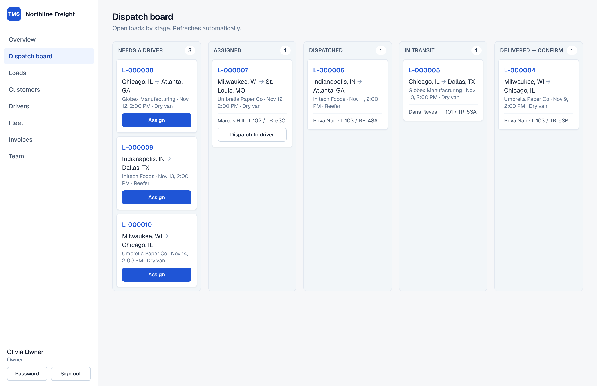
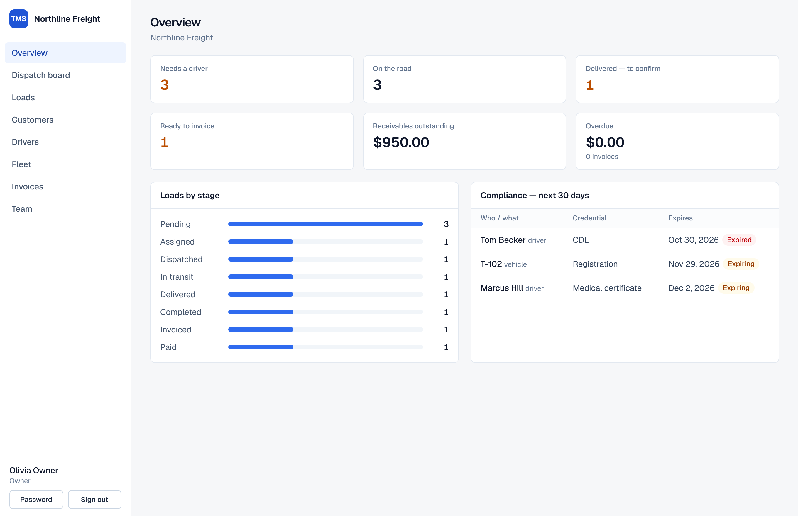
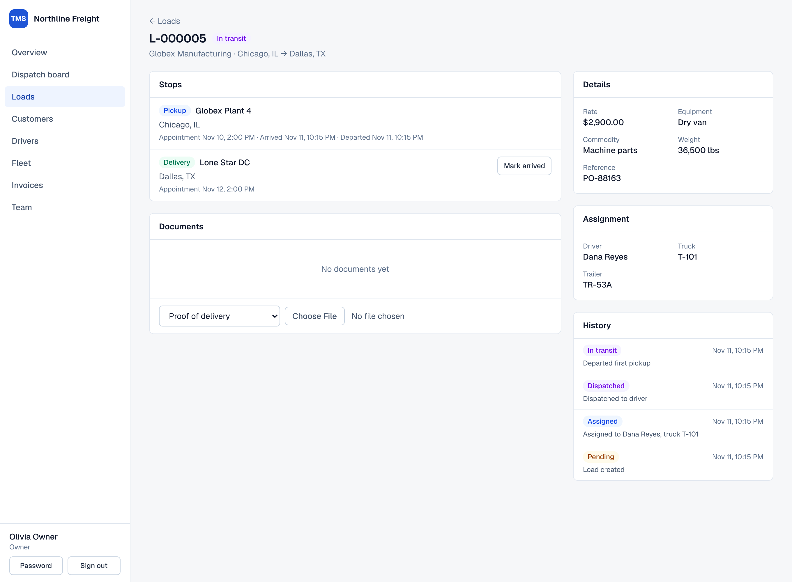
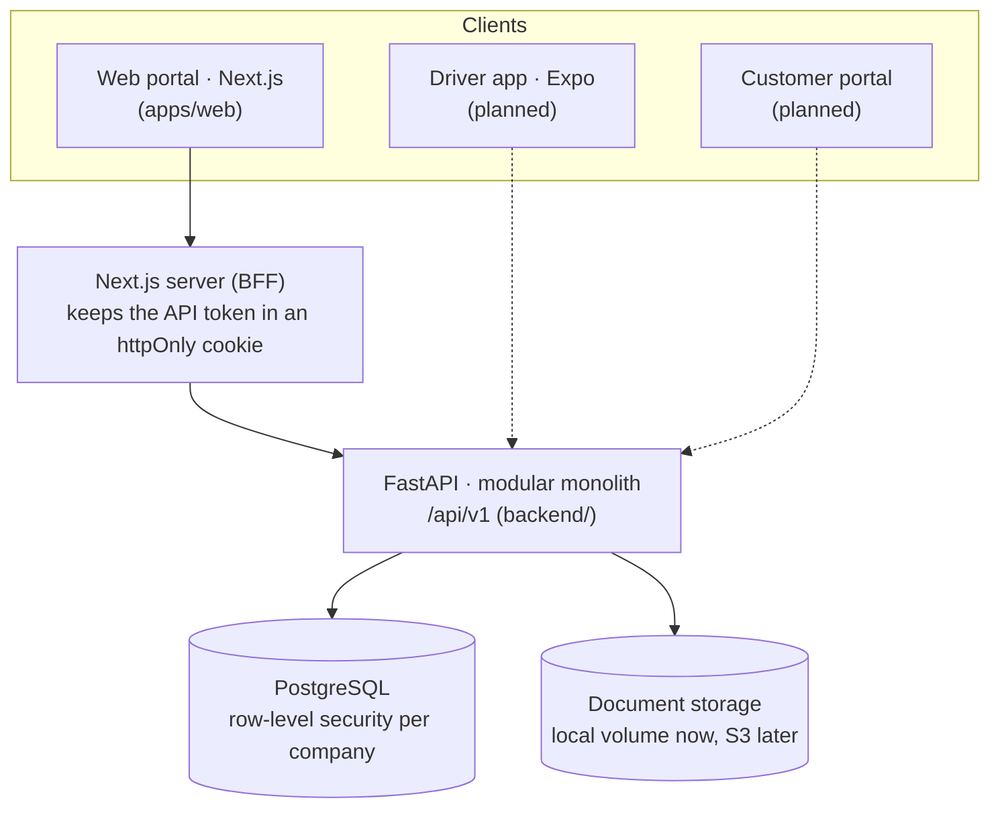

# Carrier TMS

A web-based transportation management system for trucking companies, built as a multi-tenant SaaS from day one:
your own operation is simply the first company on the platform.

This repository contains the **foundation and the first working release**: one complete, auditable load —
from order entry through dispatch, delivery, proof of delivery, invoicing and payment — for any number of
isolated companies.



| | |
| --- | --- |
|  |  |

## What works today

| Area | Included |
| --- | --- |
| Companies and users | Self-service company sign-up, team management, role-based permissions (owner, admin, dispatcher, safety, fleet, accounting, driver), password change with session revocation |
| Master data | Customers, drivers (CDL / medical tracking), trucks and trailers (insurance / registration tracking) |
| Loads | Multi-stop loads, per-company load numbers, enforced status lifecycle, full status history |
| Dispatch | Dispatch board, driver + truck + trailer assignment with compliance and availability checks |
| Tracking | Arrive / depart events per stop; status advances automatically |
| Documents | BOL / POD / receipt upload and download; delivery can't be confirmed without a POD |
| Finance | Invoice from a completed load, partial and full payments, void, receivables and overdue totals |
| Reporting | Operations overview and a 30-day compliance report |
| Driver API | Endpoints for the future mobile app, limited to the driver's own released loads, safe to retry offline |
| Platform | Tenant isolation in PostgreSQL, audit log, idempotency keys, cursor pagination, OpenAPI docs |

Not built yet: the driver mobile app, the customer portal, maps, ELD, notifications, driver settlements, and the
AWS infrastructure. See [docs/roadmap.md](docs/roadmap.md) for the full picture.

## Architecture in one minute



- **One backend, separate modules** (`organizations`, `customers`, `drivers`, `fleet`, `loads`, `dispatch`,
  `documents`, `finance`). Modules can be split into services later; nothing requires it now.
- **Tenant isolation is enforced by the database.** The API connects as a restricted role and PostgreSQL
  row-level security hides every other company's rows. An ORM-level filter adds a second, independent layer, and
  composite foreign keys make cross-company links impossible. The API refuses to start if its database role
  could bypass these rules.
- **The browser never holds the API token.** The Next.js server stores it in an httpOnly cookie and proxies
  API calls.

Details, including the security model and how to add a module: [docs/architecture.md](docs/architecture.md).

## Run it

You need Docker. For development you also need Python 3.12 or newer (developed on 3.13) and Node.js 22.

### Everything in containers

```bash
docker compose --profile app up --build
```

Open http://localhost:3000 and choose **Create an account**. API documentation is at
http://localhost:8000/api/docs.

### For development (hot reload)

Start PostgreSQL (creates both database roles and the `tms` / `tms_test` databases):

```bash
docker compose up -d
```

Start the API:

```bash
cd backend
python -m venv .venv && source .venv/bin/activate
pip install -r requirements-dev.txt
alembic upgrade head
uvicorn app.main:app --reload --port 8000
```

Start the web app in a second terminal:

```bash
cd apps/web
npm install
npm run dev
```

Optionally load a demo company (10 loads at every stage, drivers, trucks, invoices). It prints the sign-in details:

```bash
cd backend && source .venv/bin/activate
python scripts/seed_demo.py
```

`make help` lists shortcuts for all of the above.

## Test it

```bash
cd backend && pytest
```

The backend suite runs against a real PostgreSQL (the `tms_test` database from Docker Compose) and connects as
the restricted application role, so tenant isolation is tested exactly as it runs in production.

```bash
cd apps/web && npm run lint && npm run typecheck
```

End-to-end, in a real browser, with the API and web app running (first time only:
`npx playwright install chromium`):

```bash
cd apps/web && npm run e2e
```

The end-to-end test signs up a company and drives a load from creation to a paid invoice, then checks role
restrictions, password change, the phone layout, and that a second company can't see any of it.

## Configuration

Backend (`backend/.env`, see `backend/.env.example`):

| Variable | Purpose |
| --- | --- |
| `TMS_DATABASE_URL` | Runtime connection. Must be the restricted role (`tms_app`), never an owner or superuser |
| `TMS_MIGRATION_DATABASE_URL` | Schema owner (`tms_owner`), used only by Alembic |
| `TMS_JWT_SECRET` | Token signing key. Required when `TMS_ENV=production` |
| `TMS_ENV` | `development`, `test` or `production` |
| `TMS_SIGNUP_ENABLED` | Set to `false` to turn off self-service company sign-up |
| `TMS_STORAGE_DIR` | Where uploaded documents are stored |
| `TMS_CORS_ORIGINS` | Only needed for browser clients that call the API directly |

Web (`apps/web/.env.local`, see `apps/web/.env.example`):

| Variable | Purpose |
| --- | --- |
| `TMS_API_URL` | Where the Next.js server reaches the API. Default `http://localhost:8000` |

## Repository layout

```
apps/web/            Next.js web portal (TypeScript, Tailwind, TanStack Query) and its Playwright test
backend/
  app/core/          Config, database + tenancy, auth, permissions, errors, idempotency, pagination, storage
  app/modules/       One package per business module: models, schemas, router (and service where it helps)
  alembic/           Migrations: 0001 schema, 0002 row-level security, grants and auth functions
  scripts/           Demo data seeder
  tests/             API and SQL-level tests
infrastructure/      Docker assets (Terraform will live here)
docs/                Architecture, roadmap, screenshots
```

## Known limitations

These are deliberate omissions for a first release, not surprises:

- **Sign-in is local email + password** with signed tokens. Amazon Cognito, MFA, password reset by email and
  inviting an existing account into a second company are not built. Admins currently set a temporary password,
  which the user can then change.
- **Login throttling is per API process.** Real rate limiting belongs at the edge (AWS WAF).
- **Documents are stored on a local volume** behind a storage interface. The S3 adapter is not written.
- **Invoices carry a single line-haul line.** No accessorials, expenses, fuel or driver settlements yet.
- **Pickers show the first 200 records** (drivers, trucks, customers). Larger fleets need searchable pickers.
- **Dates such as "overdue" use the server's date (UTC).** There is no per-company time zone yet.
- **No background jobs.** Expiry reminders, notifications and idempotency-key cleanup need a worker.
