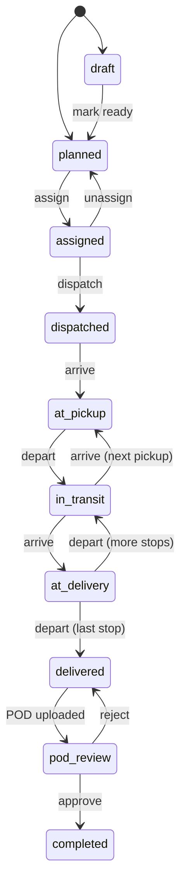

# Architecture

How BiFly is put together and, more importantly, the rules that keep it safe to extend. Read the
[README](../README.md) first for the overview. Decisions with their reasons are in [decisions](decisions).

## Shape

A **modular monolith**: one FastAPI application (`backend/app`) in which each business area is its own
package under `app/modules/`. Modules share one PostgreSQL database and call each other as plain Python.
The web application reaches the API only through its own server.

```
app/core/       config, db and tenancy, security, permissions, errors, paging, idempotency, storage, money
app/modules/
  organizations/  accounts, companies, memberships, terminals, preferences, saved views, audit log, sign-in
  customers/      customers, contacts, addresses
  drivers/        drivers, qualification files
  equipment/      trucks and trailers
  loads/          loads, stops, items, charges, notes, check calls, and the lifecycle (service.py)
  dispatch/       eligibility, assignments, the board, the driver's own endpoints
  documents/      upload contract, links, reviews
  safety/         compliance rules and the expirations queue
  finance/        invoices, payments, allocations
  reports/        dashboard, exceptions, search, reports and exports
```

Dependencies point one way. `dispatch`, `documents` and `finance` depend on `loads`; `loads` knows nothing
about how it is invoiced beyond keeping a draft invoice in step. A load's status is written in exactly one
function, `loads.service.move`.

## Accounts, companies and tenant isolation

An **account** is an owner's profile. It holds up to ten active **companies**
([decision 0001](decisions/0001-multi-company-profile.md)). The company, not the account, is the tenant:
two companies under one owner are kept apart exactly like two unrelated carriers.

**A company can never read or change another company's data.** This is enforced in three independent places.

### 1. PostgreSQL row-level security (authoritative)

- Every tenant table has an `organization_id` column and a policy
  `organization_id = current_setting('app.org_id')`, for reads and writes.
- The API connects as `bifly_app`, a role that owns nothing, is not a superuser and cannot bypass RLS.
  Migrations run separately as `bifly_owner`.
- For every transaction the session sets `app.org_id` and `app.user_id` with
  `set_config(..., is_local => true)` (see `app/core/db.py`). The values die with the transaction, so a
  pooled connection cannot carry one company's context into another request.
- With no context set, queries return nothing. The default is "see nothing", not "see everything".
- On startup the API checks its own role and **refuses to run** if that role is a superuser, has
  `BYPASSRLS`, or owns tables.
- RLS is `FORCE`d on every table, so even the schema owner is scoped by default.

`users` and `accounts` span companies, so they have their own narrow policies: a session can read itself
and co-members of its current company, and update only its own row and only a few columns.

What must work before a company is known (finding a user at sign-in, listing a person's companies, listing
an account's companies for its owner) goes through `SECURITY DEFINER` functions. They run as the schema
owner, which is given exactly the read access they need.

Working across an account's companies (copying setup into a new company, archiving) never lifts isolation.
The API opens one session bound to the source company to read and another bound to the target to write.

### 2. ORM filter (defence in depth)

Every ORM `SELECT` issued by a tenant session is also restricted to that company (`with_loader_criteria` on
the `TenantScoped` mixin), independently of the database policies.

### 3. Composite foreign keys

References between tenant tables are `(organization_id, id)` pairs, for example
`loads(organization_id, customer_id) -> customers(organization_id, id)`. A load cannot point at another
company's customer even if both other layers failed.

### Rules for new tables

1. Inherit `TenantScoped`.
2. Add `UniqueConstraint("organization_id", "id")` and refer to other tenant tables with composite keys.
3. In the migration that creates the table, pass it through `app.core.rls.secure_tenant_table`. A tenant
   table without a policy has no grant, so forgetting this fails closed.
4. `tests/test_tenancy.py` checks that every table in the schema is under forced RLS, so a miss fails CI.

## Sensitive data

Driver licence numbers are encrypted in the application before they are written (`app/core/crypto.py`), so
they never appear readable in the database, its backups or a replica.

- Roles with `drivers.sensitive.read` see the number and pay settings. Everyone else gets the last four
  characters. The same rule covers scans of licences and medical cards in the document store.
- The audit log records that the field changed, never its value.
- Keys come from `BIFLY_FIELD_ENCRYPTION_KEYS`. To rotate, put the new key first and keep the old one.

## Sign-in and sessions

- Passwords are hashed with Argon2id. The API issues a signed token (12 hours) carrying the user, the
  company and the user's `token_version`.
- On **every** request the API re-reads the membership: a role change, deactivation or removal takes effect
  on the next request. Changing a password revokes every token issued before it.
- **Switching company** re-verifies membership and issues a token for the chosen company. The last company
  a person worked in is remembered, so the next sign-in returns there; someone with several companies and
  no history is asked to choose.
- An **archived company is read-only**: every change is refused with `ORGANIZATION_ARCHIVED`, apart from
  switching away or restoring it.

Moving to Amazon Cognito later replaces token issuing and verification (`app/core/security.py`,
`get_principal`). Accounts, companies, roles and memberships stay in this database.

## Authorization

A role belongs to a membership (a person in one company). Each role maps to permissions such as
`loads.update` or `payments.record` in `app/core/permissions.py`, and every endpoint declares what it
needs. `GET /api/v1/roles` returns the matrix. Some responses are shaped by role as well: rates, licence
numbers, pay and payments are left out for roles that may not see them.

The web app hides what a role can't use, but that is presentation. The API is the enforcement point.

## Load lifecycle

See [decision 0002](decisions/0002-load-lifecycle.md) for the full table. In short:



`on_hold` and `cancelled` are reachable from the early states. Billing status (`unbilled`, `invoiced`,
`paid`) is separate and changed only by invoice and payment actions.

- Every change appends a row to `load_status_events`. The API role cannot update or delete it.
- Every change bumps the load's `version`. Clients send back the version they saw; a stale one is refused
  with `VERSION_CONFLICT` instead of overwriting someone else's work.
- The response for a load includes `allowed_actions` and `editable`, worked out from its state and the
  caller's role, so screens offer only what the API will accept.

## Assignment

Eligibility has one implementation (`dispatch/eligibility.py`), used both to explain (the assignment panel)
and to enforce (the assignment itself, and again at dispatch). A driver or unit is blocked when it is not
active, when a licence, medical card, required qualification, insurance, registration or inspection has
expired, or when it is committed to another load at the same time. Warnings (expiring soon, another
terminal, a different trailer type) are shown but do not block.

Two loads collide when their pickup-to-delivery windows overlap. A load that is under way holds its driver
and equipment until it delivers, however late it is running.

Assigning locks the driver, truck and trailer rows in a fixed order before checking, so two dispatchers
booking the same driver at the same moment cannot both succeed.

## Maintenance

A unit is off the road when its status is `in_maintenance` or `out_of_service`; dispatch only ever asks
whether it is `active`, so it never needs to know why. Two things take a unit off the road:

- a **work order** opened (or later marked) with `out_of_service`, which moves an active unit to
  `in_maintenance`;
- an **inspection** with an out-of-service result, which moves it to `out_of_service` (that outranks "in
  the shop", and a work order never softens it).

It goes back only when nothing that took it off is still open: no open work order with `out_of_service`,
and every out-of-service defect it has been cited for linked to a **completed** work order. One function
(`maintenance/service.py: return_blockers`) decides this, and both "Return to service" and editing the
unit's status go through it, so there is no side door. Completing a work order deliberately does not return
the unit by itself: someone signs it off.

Work orders are numbered per company (`WO-1001`), carry a version like loads, and are cancelled rather than
deleted. Their cost lines can change only while the work order is open; the total is recomputed under a row
lock on the work order. Inspections are a record: insert-only, apart from linking a defect to the work
order raised for it. A passed annual inspection moves the unit's inspection date a year on.

## Money

- `NUMERIC(12,2)` in the database, `Decimal` in Python, a string with two decimals in JSON.
- A **draft** invoice follows its loads: changing a load's rate or charges updates the draft.
- **Issuing** assigns the number (gapless per company), takes a snapshot of the customer's billing
  identity, and fixes the content. Database triggers refuse any later change to an issued invoice or its
  lines, whoever asks.
- Corrections are a **void** and a new invoice. Voiding frees the loads to be invoiced again.
- **Payments** are recorded once and never edited. They are applied to invoices through allocations; money
  not yet matched stays on the payment as unapplied. A mistake is **reversed**, which reopens whatever it
  had paid. "Paid", "part paid" and "overdue" are always worked out from payments and the due date.

## Documents

Metadata lives in PostgreSQL, bytes in object storage. Uploading is three steps: ask (`upload-intents`),
send the file to the address returned, confirm (`complete`). On confirmation the API checks that what
arrived is the announced size and really is a PDF or image, and discards it otherwise. With S3 the second
step becomes a presigned URL and nothing else changes.

A document can be linked to several records. Every download is authorised and logged. The approved proof of
delivery of a completed load cannot be removed.

## API conventions

See [decision 0004](decisions/0004-api-contract.md).

- **Base path** `/api/v1`. Interactive documentation at `/api/docs`, the contract at `/api/openapi.json`.
- **Errors**: `{"error": {"code", "message", "field_errors", "details", "request_id"}}`.
- **Lists**: `{"items", "page": {"next_cursor", "has_more", "total_count"}, "meta"}`. Sorting, filtering
  and paging run in the database. Sort keys and filters are allowlisted per endpoint; unknown ones are
  rejected.
- **Idempotency**: creating loads, assignments, invoices, payments, work orders and inspections, and issuing
  an invoice, accept an `Idempotency-Key`. A repeat returns the stored response; the same key with a different request is refused.
- **Dates**: instants are UTC; calendar dates (due dates, expirations, "today") are the company's local
  date, from `Principal.today()`, never the server's.
- **Correlation**: `X-Request-ID` is accepted or generated, echoed, logged, stored on audit entries and
  included in every error.

## Differences from the blueprint

| Blueprint | Now | Path |
| --- | --- | --- |
| Cognito, MFA, refresh tokens, invitations by email | Local accounts and signed tokens | [Decision 0003](decisions/0003-local-adapters-until-deployment.md) |
| S3 presigned URLs, malware scanning | Local storage behind the same three-step contract; type and size checks | Storage adapter |
| SQS workers, outbox, notifications | None; expirations are computed when read | Add with notifications |
| PostGIS, Redis | Not used | Add with mapping and caching |
| Custom roles in tables | Fixed roles, permission map in code, matrix published by the API | Tables when custom roles are needed |
| "Picked up" as its own state | Folded into `in_transit` | [Decision 0002](decisions/0002-load-lifecycle.md) |
| Shared drivers and equipment across an owner's companies | Independent copies per company | [Decision 0001](decisions/0001-multi-company-profile.md) |
| Async report jobs | Reports run in the request, with CSV export | Jobs when reports get heavy |
| Expenses, fuel, settlements | Not built yet | [Roadmap](roadmap.md) |

## Operating notes

- Run migrations as the owner role, as a separate step from starting the API (the `migrate` service in
  `docker-compose.yml`). The API never receives owner credentials.
- Never point `BIFLY_DATABASE_URL` at an owner or superuser. The API will refuse to start, by design.
- There is no platform operator who can see every company. When support access is added it should be an
  explicit, audited, time-limited grant.
