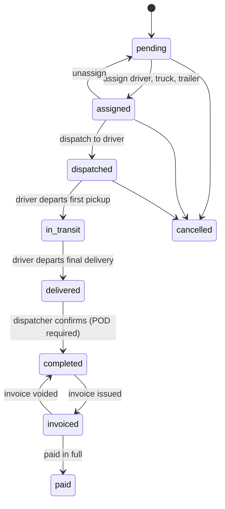

# Architecture

This document explains how the system is put together and, more importantly, the rules that keep it safe to
extend. Read the [README](../README.md) first for the overview.

## Shape

A **modular monolith**: one FastAPI application (`backend/app`) in which each business area is its own package
under `app/modules/`. Modules share one PostgreSQL database and talk to each other through plain Python calls.
The web portal (`apps/web`) is a Next.js application that reaches the API only through its own server.

```
app/core/       cross-cutting: config, db + tenancy, security, permissions, errors, idempotency, pagination
app/modules/
  organizations/  companies, users, memberships, audit log, auth endpoints
  customers/      customers
  drivers/        drivers and qualification dates
  fleet/          trucks and trailers
  loads/          loads, stops, status history, the lifecycle rules (service.py)
  dispatch/       assignments, dispatch board, driver app endpoints
  documents/      BOL / POD / receipts
  finance/        invoices, lines, payments
app/api/        endpoints that read across modules (reports)
```

Dependencies point one way: `dispatch`, `documents` and `finance` depend on `loads`; nothing depends on them.
Every load status change in any module goes through `loads.service.change_status`.

## Tenant isolation

This is the property everything else rests on: **a company can never read or change another company's data.**
It is enforced in three independent places.

### 1. PostgreSQL row-level security (authoritative)

- Every tenant table has an `organization_id` column and a policy
  `organization_id = current_setting('app.org_id')`, for reads and writes.
- The API connects as `tms_app`, a role that owns nothing, is not a superuser, and cannot bypass RLS.
  Migrations run separately as `tms_owner`.
- For every transaction, the session sets `app.org_id` and `app.user_id` with `set_config(..., is_local => true)`
  (see `app/core/db.py`). The values die with the transaction, so a pooled connection cannot carry one company's
  context into another request.
- With no context set, queries return nothing. The default is "see nothing", not "see everything".
- On startup the API checks its own role and **refuses to run** if that role is a superuser, has `BYPASSRLS`,
  or owns tables.
- RLS is `FORCE`d on every table, so even the schema owner is tenant-scoped by default. A data fix run as the
  owner has to set a company context, or lift `FORCE` explicitly inside a migration.

`users` are global identities (one person may belong to several companies), so that table has its own policies:
a session may read itself and co-members of its current company, and update only its own row, and only the
`full_name`, `password_hash` and `token_version` columns.

The few operations that must work before a company is known — looking up a user by email at login, listing the
companies a user belongs to, creating a user — are `SECURITY DEFINER` functions (`auth_lookup_user`,
`auth_user_organizations`, `auth_create_user`). They run as the schema owner, which is given exactly what they
need and nothing else: policies named `definer_read` on the three identity tables and `definer_insert` on
`users` (migration `0003`).

### 2. ORM filter (defence in depth)

Every ORM `SELECT` issued by a tenant session is automatically restricted to that company
(`with_loader_criteria` on the `TenantScoped` mixin). It is independent of the database policies and is tested
by deliberately pointing the database context at the wrong company.

### 3. Composite foreign keys

References between tenant tables are `(organization_id, id)` pairs, for example
`loads(organization_id, customer_id) -> customers(organization_id, id)`. A load cannot point at another
company's customer even if both other layers failed.

### Rules for new tables

1. Inherit `TenantScoped` (gives you `organization_id`).
2. Add `UniqueConstraint("organization_id", "id")` and reference other tenant tables with composite foreign keys.
3. Add the table to `TENANT_TABLES` in a new migration so it gets the policy and grants. A tenant table without
   a policy is invisible to the API (no grant), so forgetting this fails closed.
4. Add an isolation test for it in `tests/test_tenancy.py`.

## Sensitive data

Driver licence numbers are encrypted in the application before they are written (`app/core/crypto.py`), so
they never appear in the database, its backups, or a replica in readable form.

- Roles that manage driver qualification (`drivers:write`) see the number. Everyone else sees the last four
  characters. It is not searchable.
- The audit log records that the field changed, never its value.
- Keys come from `TMS_FIELD_ENCRYPTION_KEYS`. To rotate, put the new key first and keep the old one: new
  writes use the new key and old rows still decrypt. Losing the keys loses the data, so back them up with the
  same care as the database.

To protect another column the same way: use the `EncryptedText` column type, mask it in the module's response
for roles that don't need it, and list it in `audit_redact`.

## Authentication and sessions

- Passwords are hashed with Argon2id.
- The API issues a signed token (HS256, 12 hours) carrying the user, the company, and the user's `token_version`.
- On **every** request the API re-reads the membership: role changes and deactivation take effect immediately,
  not when the token expires. Changing a password bumps `token_version`, which revokes every token issued before.
- The web portal uses a backend-for-frontend: `apps/web/app/api/session/*` exchanges credentials for a token and
  stores it in an `httpOnly`, `SameSite=Lax` cookie; `apps/web/app/api/tms/[...path]` forwards API calls with
  that token. Page scripts cannot read it. State-changing requests are also checked for same origin.

Moving to Amazon Cognito later means replacing token issuing and verification (`app/core/security.py`,
`get_principal` in `app/core/deps.py`). Roles and memberships stay in this database.

## Authorization

Roles belong to a membership (a user in a company): `owner`, `admin`, `dispatcher`, `safety_manager`,
`fleet_manager`, `accountant`, `driver`, `customer`. Each role maps to a set of permissions in
`app/core/permissions.py`, and every endpoint declares the permission it needs with `Depends(require("…"))`.

Drivers hold only `driver:self` and can use only `/api/v1/driver/*`, where every query is tied to their own
active assignment and loads appear only once dispatched. They are never shown the customer's rate.

The web portal hides what a role can't use, but that is a convenience. The API is the enforcement point.

## Load lifecycle



The transition table lives in `app/modules/loads/service.py`. Anything not listed is rejected with `409`. Every
change appends a row to `load_status_events`; the API role has no `UPDATE` or `DELETE` on that table or on
`audit_logs`, so history cannot be rewritten through the application.

Assignment checks (all against the pickup date): driver active with unexpired CDL and medical certificate;
truck and trailer active with unexpired insurance and registration; trailer type matches the load's equipment;
none of the three is on another load that is currently dispatched or in transit.

## API conventions

- **Base path** `/api/v1`. Interactive documentation at `/api/docs`.
- **Errors** are always `{"error": {"code", "message", "details"}, "request_id"}`. Validation errors list
  `{field, message}` pairs in `details`.
- **Correlation ids**: send `X-Request-ID` or one is generated; it is echoed back, logged, and stored on audit
  entries.
- **Pagination** is cursor-based: list endpoints return `{items, next_cursor}`; pass `cursor` to continue.
- **Idempotency**: load creation, assignment, stop events, invoice creation and payments accept an
  `Idempotency-Key` header.
  A repeat with the same key returns the stored response (`Idempotent-Replay: true`) without doing the work
  again; reusing a key for a different request is rejected. Stop events are additionally idempotent by nature,
  so a driver's phone can resend queued events after reconnecting.
- **Concurrency**: operations that change a load lock its row first (`SELECT … FOR UPDATE`), and uniqueness
  rules that matter (one active assignment per load, one live invoice per load) are database indexes.
- **Money** is `NUMERIC(12,2)` in the database and `Decimal` in Python; it is serialized as a string. Every load,
  invoice and payment stores its currency (only USD is accepted today).
- **Financial records are corrected, not edited.** Invoices are voided rather than deleted, and the API's
  database role cannot update or delete payments or invoice lines.
- **Business dates are the company's local dates.** Each company has a time zone; invoice dates, due dates,
  "overdue" and expiry checks use `Principal.today()`, never the server's date.

## Documents

Files are stored through a two-method interface (`app/core/storage.py`); metadata lives in `documents`.
Storage keys are `<organization>/<document id>` and never contain user-supplied names. Uploads are limited to
15 MB and to PDF and common image types, and downloads are always served as attachments. The production
adapter should use a private S3 bucket with short-lived signed URLs.

## Differences from the blueprint

The implementation follows the architecture blueprint's decisions and rules. Where it is simpler than the
blueprint's full schema, that is deliberate scope for a first release, and each item below has a clear path to
the blueprint's shape.

### Infrastructure and stack

| Blueprint | Now | Why |
| --- | --- | --- |
| Amazon Cognito (OIDC), MFA, refresh tokens | Local accounts, 12-hour signed tokens, revocation by token version | Lets the whole system run and be tested with no cloud account. The seam for Cognito is small |
| PostGIS | Plain PostgreSQL | Nothing uses geography yet. Add the extension with the first mapping feature |
| Redis, SQS workers, outbox events | None | Nothing is asynchronous yet. Introduce with reminders and notifications |
| S3 with signed URLs | Local volume behind a storage interface; downloads go through the API | Same reason as Cognito |
| shadcn/ui, TanStack Table, React Hook Form + Zod | Tailwind with a small in-house component set, TanStack Query | Kept the first release dependency-light. Adopt screen by screen |
| Terraform, ECS, CloudFront/WAF | Dockerfiles and Docker Compose | Images are ready for ECS. The infrastructure itself is the next phase |
| Testcontainers | A real PostgreSQL from Docker Compose (or the CI service container) | Same guarantee, one less moving part |

### Data model

| Blueprint | Now |
| --- | --- |
| `roles`, `permissions`, `role_permissions`, `membership_roles` tables; several roles per member | One role per membership, with the role-to-permission map in code (`app/core/permissions.py`) |
| `invitations` | Not built. An admin creates the user with a temporary password |
| `terminals`, `addresses` (with coordinates) | Not built. Addresses are fields on stops and customers |
| `customer_contacts` | Not built. One billing contact on the customer |
| `driver_licenses`, `driver_qualifications` | CDL fields and medical-certificate expiry directly on `drivers` |
| `load_items`, `rate_confirmations`, `tracking_events` | Not built. Commodity and weight are on the load |
| `dispatch_assignments.accepted_at` and a driver "accept" step | Not built. A dispatched load is visible to its driver immediately |
| `documents` + `document_links` (any entity), checksums | Documents belong to a load |
| Invoices spanning several loads, `subtotal` / `tax` | One invoice per load with a single line-haul line |
| `expenses`, `fuel_transactions`, `driver_settlements` | Not built |
| `integrations`, `webhook_*`, `outbox_events` | Not built |
| `audit_logs` with before/after snapshots and IP address | Records the changed fields and the request id |

### Behaviour

| Blueprint | Now |
| --- | --- |
| Optimistic concurrency (version or `updated_at` precondition) on assignments and load status | Row locks plus the explicit state machine and unique indexes. Conflicting changes are rejected with `409`; plain edits to a load are last-write-wins |
| Idempotency keys expire | Keys are kept indefinitely until a cleanup job exists |
| Malware scanning of uploads | File type and size are validated; no scanning |
| Platform operator role with audited, time-limited support access | Not built. There is no cross-company access of any kind |

## Operating notes

- Run migrations as the owner role, as a separate step from starting the API (see the `migrate` service in
  `docker-compose.yml`). The API container should never receive owner credentials.
- Never point `TMS_DATABASE_URL` at an owner or superuser. The API will refuse to start, by design.
- Platform-level administration (support access across companies) is intentionally absent. When it is added it
  should be an explicit, audited, time-limited grant, not a role that sees everything.
